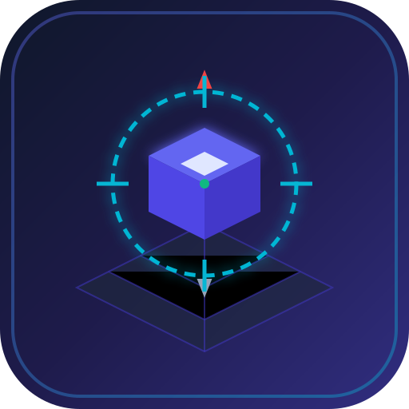

# Roblox Macro Studio (로블록스 3D 시점 보정 & OpenCV 5 비전 매크로)

<div align="center">



[](https://github.com/ko9ma7/RobloxMacroStudio/actions)
[](LICENSE)
[](https://dotnet.microsoft.com/)
[](https://github.com/shimat/opencvsharp)
[]()

**LDPlayer 안드로이드 에뮬레이터 및 로블록스 3D 환경 전용 시점 보정 & 비전 기반 C# WPF 매크로 스튜디오**

</div>

---

## 📌 1. 개요 및 해결하려는 핵심 과제

일반적인 2D 게임 매크로(단순 픽셀 찾기, 템플릿 매칭)를 **로블록스(Roblox)와 같은 3D 게임**에 그대로 적용하면 다음과 같은 치명적인 문제가 발생합니다:

1. **3D 원근 왜곡 및 크기 변화 (Perspective & Scale Drift)**: 캐릭터의 카메라 줌 거리나 고도에 따라 대상 오브젝트나 몬스터의 크기·형태가 계속 축소/확대되거나 각도가 틀어집니다.
2. **시점 회전과 이동 방향의 불일치 (Yaw / Heading Disorientation)**: 로블록스의 캐릭터 이동(`W`, `A`, `S`, `D`)은 **현재 카메라가 바라보는 시점 각도를 기준**으로 동작합니다. 카메라가 5도만 틀어져도 전혀 엉뚱한 방향으로 이동하게 됩니다.
3. **조명 및 그림자 변화로 인한 매칭 실패**: 3D 실시간 조명 및 낮/밤 주기로 인해 동일한 물체라도 RGB 픽셀 값이 완전히 달라집니다.

**Roblox Macro Studio**는 이러한 3D 환경의 한계를 극복하기 위해 **"시점 정규화(Camera Normalization)"**, **"다중 스케일 OpenCV 템플릿 매칭"**, **"HSV 색상 공간 분할"**, **"2D HUD 앵커링"** 기법을 통합 구현한 C# WPF 기반 전문 자동화 프로그램입니다.

---

## ✨ 2. 핵심 기능

### 🎯 1. 직관적인 대상 창 선택 (Target Window Picker)
* **크로스헤어 드래그 앤 드롭 (Drag to Target)**: Spy++, Process Hacker 스타일로 십자선 아이콘을 마우스로 끌어서 LDPlayer 창 위에 놓으면 HWND, 프로세스명, 클라이언트 해상도를 자동으로 즉각 캡처하여 바인딩합니다.
* **에뮬레이터 자동 감지**: 실행 중인 LDPlayer, BlueStacks, Nox 프로세스를 목록에서 자동 감지하여 추천합니다.
* **백그라운드 입력 지원 (PostMessage)**: LDPlayer의 내부 Direct3D/OpenGL 렌더 캔버스(`RenderWindow`)를 탐색하여 창이 다른 프로그램에 가려져 있어도 백그라운드 클릭 및 키 입력이 가능합니다 (전경 `SendInput` 모드 전환 지원).

### 🧭 2. 3D 시점 왜곡 및 이동 보정 알고리즘 (Roblox 3D Stabilization)
* **1인칭 줌 스냅 정규화 (`ZoomFirstPersonAndOut`)**:
  - `I` 키를 연속 입력하여 1인칭 시점으로 강제 진입시키면, **카메라 시점(Yaw/Pitch)이 아바타의 정면 방향과 100% 일치**하게 정렬됩니다.
  - 그 직후 `O` 키를 정해진 횟수만큼 줌아웃시켜 **매 루프마다 수학적으로 동일한 3인칭 시점 거리와 각도를 복원**합니다.
* **컴퍼스/랜드마크 360도 스윕 정렬 (`SweepAndAlignCompass`)**:
  - 우클릭 드래그로 카메라를 일정 각도씩 회전시키며 미니맵의 나침반(N 극)이나 고정 랜드마크를 OpenCV로 탐색하여 원하는 각도에 정확히 정렬합니다.
* **탑다운 버드아이 뷰 틸트 (Top-Down Bird's Eye)**:
  - 화면 중심에서 우클릭 상향 드래그를 실행하여 카메라를 완전 수직 탑다운 시점으로 전환합니다. 3D 원근 왜곡을 사실상 2D 평면 좌표계로 변환하여 이동 경로의 오차를 제거합니다.
* **쉬프트락 토글 (Shift-Lock)**:
  - 아바타의 방향을 십자선 중앙으로 즉시 강제 정렬합니다.

### 👁️ 3. 강력한 컴퓨터 비전 엔진 (OpenCvSharp4)
* **다중 스케일 템플릿 매칭 (Multi-Scale Pyramid Matching)**:
  - 템플릿 이미지를 0.8배 ~ 1.2배(스텝 0.05) 크기로 가변 변환하면서 매칭을 수행합니다. 캐릭터의 거리가 약간 달라져도 대상 이미지를 안정적으로 검출합니다.
* **HSV 색상 영역 검출 (Immune to Lighting Shifts)**:
  - 조명에 민감한 RGB 대신 색상(Hue), 채도(Sat), 명도(Val) 기반 마스킹과 윤곽선(Contour) 분석을 통해 퀘스트 마커, 자원, 낚시 게이지 등을 조명 변화에 관계없이 검출합니다.
* **관심 영역(ROI) 지정 & 캔버스 1클릭 템플릿 스닙**:
  - 실시간 미리보기 화면에서 마우스로 영역을 드래그하면, **1클릭으로 즉시 PNG 템플릿으로 저장**하거나 **해당 영역만 탐색하도록 ROI를 설정**할 수 있습니다.

### 📝 4. 비주얼 시퀀스 에디터 & 스크립트 엔진
* **지원 액션 유형**:
  - `MoveUntilCheckpoint`: **목표 지점 도달 시 즉각 정지 및 시점 회전** (앞으로 전진하다 체크포인트 발견 시 `KeyUp` 후 카메라 90도 회전/스냅)
  - `FindImage`: 템플릿 매칭 (임계값, 다중스케일 0.8x-1.2x, ROI)
  - `FindColor`: HSV 색상 블롭 검출 (조명/그림자 무관)
  - `Click`: 고정 좌표 / 마지막 검출 위치 중심(`LastMatchCenter`) / 화면 중심 클릭 (좌/우/더블)
  - `Drag`: 시점 회전 및 인벤토리 아이템 드래그
  - `KeyPress`: 비활성창 전용 스캔코드 펄스 키보드 입력 (`W`, `A`, `S`, `D`, `Space`, `E`, `I`, `O` 등)
  - `CalibratedMove`: 방향 이동 후 앵커 위치 재검증 보정 이동
  - `RobloxCameraReset`: 로블록스 전용 시점 정규화 루틴 (1인칭 줌 스냅)
  - `RobloxCameraSweep`: 회전 스윕 앵커 탐색
  - `Delay`: 사람과 유사한 지연(Human-like Anti-detection Jitter ±15%)
  - `ConditionBranch`: 이미지 검출 성공/실패 여부에 따른 스텝 점프 및 예외 복구
  - `LogMessage`: 사용자 정의 상태 로깅
* **JSON 기반 스크립트 저장/불러오기**: `.macro.json` 포맷으로 다른 사용자와 손쉽게 공유 가능.
* **글로벌 핫키 지원**: 게임 화면에 포커스가 있는 상태에서도 `F5`(시작), `F6`(정지), `F7`(일시정지)으로 원격 제어 가능.

---

## 🏛️ 3. 시스템 아키텍처

```
┌─────────────────────────────────────────────────────────────┐
│                   RobloxMacroStudio (WPF)                   │
├──────────────────────────────┬──────────────────────────────┤
│  MainWindow.xaml / CS        │  MainViewModel (MVVM)        │
│  - Dark Fluent Theme         │  - Window Selection State    │
│  - Drag Crosshair Picker     │  - Script & Action Editor    │
│  - Interactive Snipper       │  - Live Bitmap Preview       │
│  - Hotkey Hooks (F5/F6/F7)   │  - Structured Event Logs     │
└──────────────┬───────────────┴──────────────┬───────────────┘
               │                              │
               ▼                              ▼
┌──────────────────────────────┐┌─────────────────────────────┐
│      Win32 Services          ││     OpenCV Vision Engine    │
├──────────────────────────────┤├─────────────────────────────┤
│ • Win32CaptureService        ││ • OpenCvVisionService       │
│   - PrintWindow FullContent  ││   - MatchTemplate           │
│   - BitBlt Fallback          ││   - Multi-Scale Pyramid     │
│   - Client Coordinate Map    ││   - HSV Color InRange       │
│ • WindowsInputService        ││   - Contour Blob Detection  │
│   - PostMessage (Background) ││   - Visual Bounding Overlay │
│   - SendInput (Foreground)   │└──────────────┬──────────────┘
│   - LDPlayer RenderWindow    │               │
└──────────────┬───────────────┘               │
               │                               │
               ▼                               ▼
┌─────────────────────────────────────────────────────────────┐
│                 Roblox 3D Camera Service                    │
├─────────────────────────────────────────────────────────────┤
│ • ResetCameraZoomAsync: Zoom In ('I') -> Zoom Out ('O')     │
│ • SweepAndAlignCompassAsync: Right-drag Yaw Alignment       │
│ • TiltToTopDownAsync: Top-down Bird's-Eye Perspective       │
│ • ToggleShiftLockAsync: Centered Avatar Orientation         │
└──────────────────────────────┬──────────────────────────────┘
                               │
                               ▼
┌─────────────────────────────────────────────────────────────┐
│                     MacroEngine (Async)                     │
│  - Background CancellationToken Loop                        │
│  - ExecutionContext (LastMatch, Step, Variables)            │
│  - Human Jitter Timing & Error Recovery Branching           │
└─────────────────────────────────────────────────────────────┘
```

---

## 📂 4. 디렉터리 구조

```text
로블록스매크로/
├── RobloxMacroStudio.csproj    # .NET 8.0 WPF 프로젝트 설정 및 NuGet 의존성
├── app.manifest                # 고DPI (PerMonitorV2) 및 Windows 10/11 매니페스트
├── App.xaml / App.xaml.cs      # WPF 애플리케이션 진입점
├── MainWindow.xaml / .cs       # 3패널 다크 테마 메인 윈도우 UI
├── EnumBindingSource.cs        # XAML Enum ComboBox 바인딩 확장
│
├── Models/                     # 데이터 도메인 모델
│   ├── WindowInfo.cs           # HWND, 타이틀, 클래스명, 해상도, 에뮬레이터 식별
│   ├── MacroAction.cs          # 시퀀스 액션 정의 (다형성 지원)
│   ├── MacroScript.cs          # 스크립트 메타데이터 및 JSON 직렬화
│   ├── TemplateMatchResult.cs  # 좌표, 신뢰도, 스케일 비율, BoundingBox
│   └── MacroLogEntry.cs        # 로그 레벨(Info/Success/Warn/Error) 및 타임스탬프
│
├── Services/                   # 핵심 서비스 계층
│   ├── IWindowCaptureService.cs / Win32CaptureService.cs
│   ├── IInputSimulationService.cs / WindowsInputService.cs
│   ├── IVisionService.cs / OpenCvVisionService.cs
│   ├── IRobloxCameraService.cs / RobloxCameraService.cs
│   ├── WindowPickerService.cs  # 마우스 커서 위치 윈도우 추적 및 빨간 테두리 하이라이트
│   └── GlobalHotkeyService.cs  # RegisterHotKey (F5, F6, F7)
│
├── Engine/                     # 매크로 실행 런타임
│   ├── MacroEngine.cs          # 비동기 실행 루프, 일시정지, 예외 분기 제어
│   └── ExecutionContext.cs     # 런타임 상태, 마지막 검출 좌표, 루프 카운터
│
├── ViewModels/                 # MVVM 뷰모델
│   ├── MainViewModel.cs        # 메인 UI 상태 및 명령 로직
│   └── RelayCommand.cs         # ICommand 구현체
│
├── Presets/                    # 사전 구성된 예제 스크립트
│   ├── Roblox_3D_Camera_Stabilization_Sample.macro.json # 시점 보정 & 이동 샘플
│   └── Roblox_Auto_Farming_Loop.macro.json              # HSV 자원 파밍 루프
│
├── Assets/                     # 아이콘 및 리소스
│   ├── app-icon.svg            # 고화질 벡터 아이콘
│   ├── app-icon.png            # 256x256 래스터 아이콘
│   └── favicon.ico             # 윈도우 실행 파일 아이콘
│
├── .github/
│   └── workflows/
│       └── build-and-release.yml # GitHub Actions 자동 빌드 & 릴리즈 워크플로우
├── .gitignore / .gitattributes / LICENSE
├── github-bootstrap.cmd        # 윈도우 원클릭 깃허브 배포 스크립트
└── README.md                   # 문서
```

---

## 🚀 5. 설치 및 실행 방법

### 요구 사양
* **운영체제**: Windows 10 (1903 이상) 또는 Windows 11
* **런타임**: [.NET 8.0 Desktop Runtime](https://dotnet.microsoft.com/download/dotnet/8.0)
* **에뮬레이터 권장 설정 (LDPlayer)**:
  - 해상도: `1280 x 720` (DPI: 240) 또는 `960 x 540`
  - 그래픽 모드: DirectX 또는 OpenGL (PrintWindow 호환)

### 로컬 빌드 및 실행
```powershell
# 1. 저장소 클론
git clone https://github.com/ko9ma7/RobloxMacroStudio.git
cd RobloxMacroStudio

# 2. 패키지 복원 및 빌드
dotnet build -c Release

# 3. 애플리케이션 실행
dotnet run -c Release
```

---

## 🎮 6. 상세 사용 가이드

### 단계 1: 대상 창 선택 (LDPlayer)
1. LDPlayer를 실행하고 로블록스 게임에 접속합니다.
2. 상단 툴바의 **"🎯 Drag to Target"** 버튼을 마우스 왼쪽 버튼으로 누른 채 LDPlayer 창 위로 드래그합니다.
3. 마우스를 놓으면 자동으로 해당 창이 선택되고, 화면 스냅샷이 중앙 캔버스에 표시됩니다.
4. 필요시 **"Background Mode"** 체크박스를 켜서 창이 가려져도 작동하도록 설정합니다.

### 단계 2: 3D 시점 보정 액션 추가
1. 왼쪽 시퀀스 창에서 `➕ Add Action` -> `🎯 3D Camera Reset (Roblox)`을 선택합니다.
2. `CameraResetMode`를 `ZoomFirstPersonAndOut`으로 지정합니다.
   - `Zoom In Steps ('I')`: 기본값 `8` (1인칭 시점 진입)
   - `Zoom Out Steps ('O')`: 기본값 `5` (표준 거리 줌아웃)
3. 이동하기 직전에 항상 이 액션이 실행되도록 배치하여 카메라 각도를 고정시킵니다.

### 단계 3: 템플릿 이미지 캡처 (1클릭 스닙)
1. 중앙 캔버스에 표시된 게임 화면에서 찾고자 하는 버튼, 아이콘, 퀘스트 마커를 마우스로 드래그하여 사각형 박스를 그립니다.
2. 아래쪽의 **"✂️ Snip Template PNG"** 버튼을 누릅니다.
3. 파일명을 지정하고 저장하면, 현재 선택된 `FindImage` 액션에 경로가 즉시 자동 등록됩니다.

### 단계 4: 매크로 구동 및 제어
* **F5**: 매크로 시작 (Start)
* **F7**: 일시정지 / 다시 시작 (Pause / Resume)
* **F6**: 매크로 중단 (Stop)
* 하단 **Execution Logs**에서 각 단계별 이미지 매칭 점수, 인식 좌표, 소요 시간을 실시간 모니터링할 수 있습니다.

---

## ⚡ 7. Windows 원클릭 GitHub Bootstrap (`github-bootstrap.cmd`)

이 저장소에는 GitHub Repository 생성 및 최초 빌드/배포를 한 번에 완료하는 **`github-bootstrap.cmd`** 스크립트가 포함되어 있습니다.

```cmd
:: 프로젝트 루트 디렉터리에서 더블 클릭 또는 명령 프롬프트에서 실행:
github-bootstrap.cmd
```

### 스크립트 자동 처리 내역:
1. `[CHECK]` Git 및 .NET 8.0 SDK 설치 상태 검사
2. `[CHECK]` GitHub CLI(`gh`) 및 로그인 세션(`gh auth status`) 검사 (미로그인 시 안내)
3. `[CHECK]` 로컬 Git 저장소 초기화 및 기본 브랜치 `main` 설정
4. `[CHECK]` Release 모드 무결성 빌드 검증 (`dotnet build -c Release`)
5. `[CHECK]` GitHub 원격 저장소(`RobloxMacroStudio`) 생성 및 연결 (Idempotent 처리)
6. `[CHECK]` Conventional Commit 메시지로 최초 커밋 생성 및 푸시
7. `[CHECK]` GitHub Topics 메타데이터 자동 추가 (`roblox-macro`, `opencv`, `wpf`, `ldplayer` 등)
8. `[CHECK]` 초기 릴리즈 태그 `v1.0.0` 푸시 -> GitHub Actions 자동 빌드 & zip 에셋 릴리즈 트리거
9. `[SUCCESS]` 최종 생성된 GitHub Repository 및 Actions URL 출력

---

## 📄 8. 라이선스

본 프로젝트는 [MIT 라이선스](LICENSE)에 따라 자유롭게 수정, 배포, 상업적 이용이 가능합니다.  
게임 자동화 봇 이용 시 해당 게임의 운영 정책 및 서비스 약관을 준수하시기 바랍니다.
